# Subscription Management System — PS Module Breakdown

**Source:** `Subscription_Management_System.pdf` (Brightloop Software scenario)
**Goal:** One unified platform that runs the full life of a subscription business — products & plans → quotations → subscriptions → automated recurring invoices → discounts/taxes → payments → revenue reporting.

> All diagrams below are **Mermaid** — they render automatically on GitHub, GitLab, Notion, VS Code and most Markdown viewers. (The in-app preview may show the raw code if it can't load the Mermaid renderer.)

---

## 0. Pain → Feature map (from "How Things Run Today")

| Today's pain (PS) | Module that fixes it |
|---|---|
| Subscriptions tracked in a spreadsheet | M5 Subscription Management |
| Renewals remembered by whoever notices first | M5 lifecycle + M11 renewal reminders |
| Invoices typed by hand every month | M6 Billing & Invoicing Engine |
| Payments matched via bank statements | M8 Payments & Reconciliation |
| Revenue reports built manually each quarter | M10 Dashboard & Reports |
| Nobody knows actual recurring revenue | M10 summary/MRR + M6 auto totals |

---

## 1. Module list

| # | Module | One-liner |
|---|--------|-----------|
| M1 | Authentication & Access Control (RBAC) | Accounts, password policy, reset link, roles: admin / staff / customer |
| M2 | Product & Variant Catalog | Admin-defined products with variants that change price (e.g. Odoo +560) |
| M3 | Plan Management | Recurring plans: price, frequency, min qty, availability window, end-behavior flags |
| M4 | Quotation Templates | Reusable offer templates valid for N days; convert quote → subscription |
| M5 | Subscription Management | The core: numbered subscription, lines, state machine, pause/renew/close |
| M6 | Billing & Invoicing Engine | Automated billing-day invoice generation, idempotent, auto taxes/discounts, Draft→Confirmed→Paid |
| M7 | Tax & Discount Rules Engine | Admin rules auto-applied on invoices; discounts self-expire |
| M8 | Payments & Outstanding Tracking | Record payments against invoices; paid vs overdue visibility, aging |
| M9 | Customer Self-Service Portal | Customers see/manage only their own subscriptions & invoices |
| M10 | Dashboard, Reports & Analytics | Finance view: active subs, revenue in/owed, overdue, filters, summary — <2 s at scale |
| M11 | Notifications & Audit | Renewal/overdue reminders, invoice-sent emails, full audit trail |

---

## 2. Architecture — module dependency diagram (Mermaid)

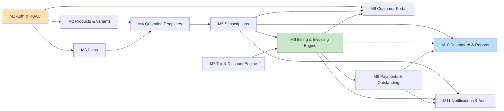

**Reading:** M1 gates every module (JWT + role checks on all routes). M2+M3 feed M4 → M5 → M6 → M8 → M10 is the money pipeline. M7 plugs into M6 (every invoice auto-gets taxes/discounts). M9 is a read/manage view over M5+M6 scoped to the logged-in customer. M11 observes M5+M6+M8.

---

## 3. Workflows (Mermaid)

### 3.1 Authentication & RBAC flow (M1)

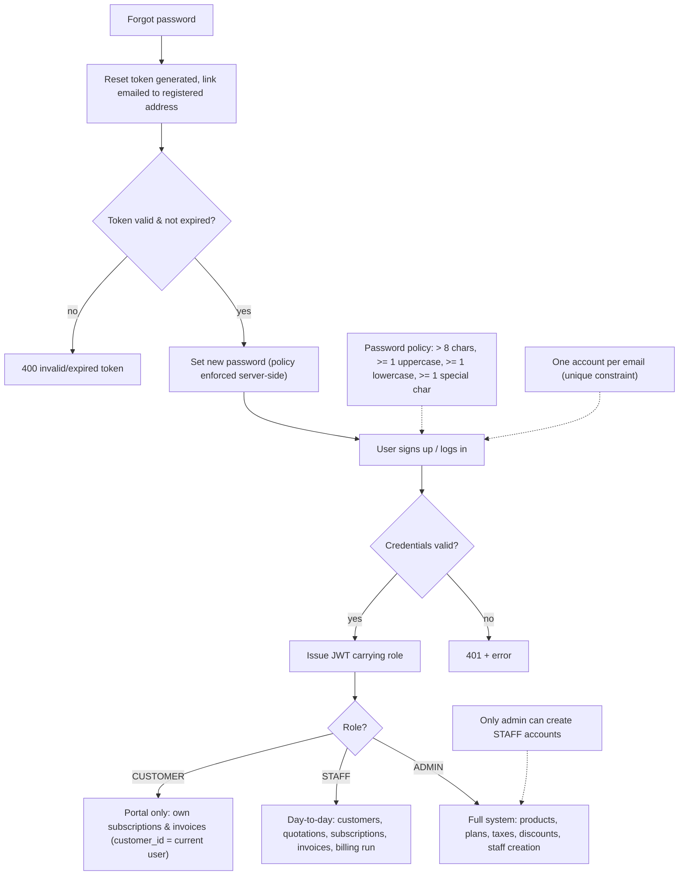

### 3.2 Quotation template → subscription flow (M4 → M5)

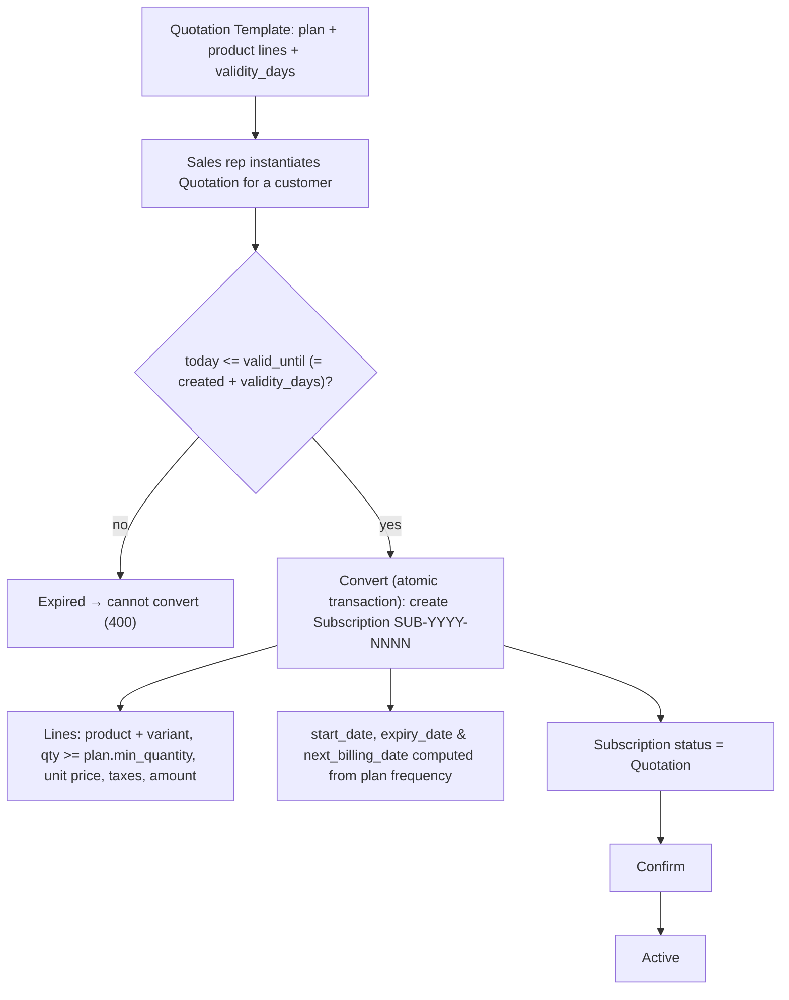

### 3.3 Subscription lifecycle — state machine (M5)

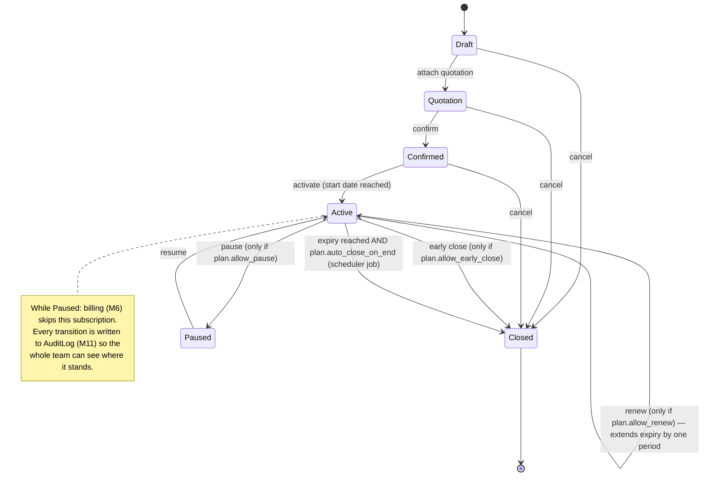

### 3.4 Billing day — automated invoice generation (M6 + M7)

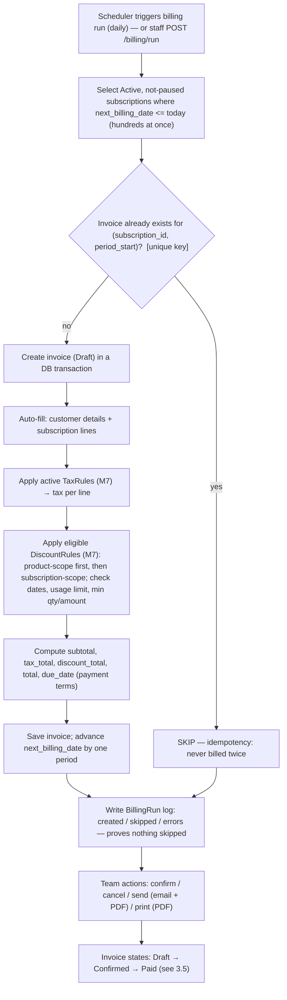

### 3.5 Invoice lifecycle — state machine (M6 + M8)

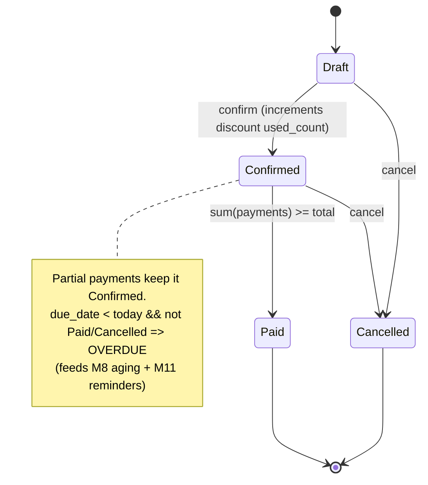

### 3.6 Tax & discount evaluation engine (M7, called by M6)

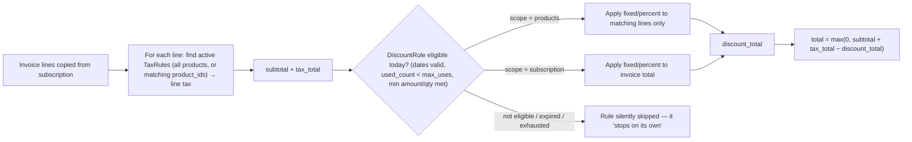

### 3.7 Payment recording & overdue chasing (M8 + M11)

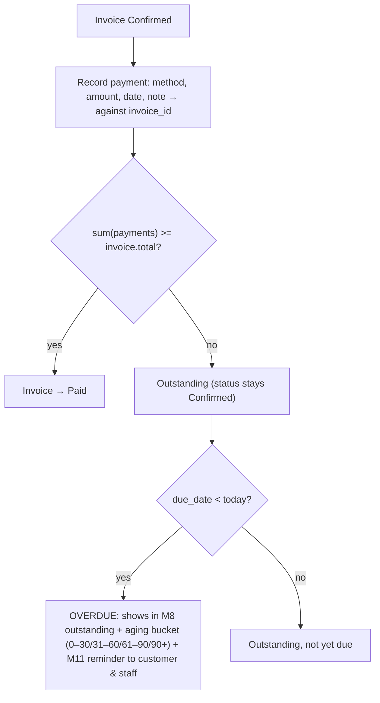

### 3.8 Customer portal — data isolation (M9)

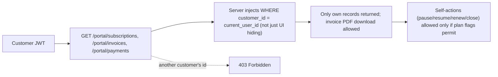

### 3.9 End-of-month finance flow (M10)

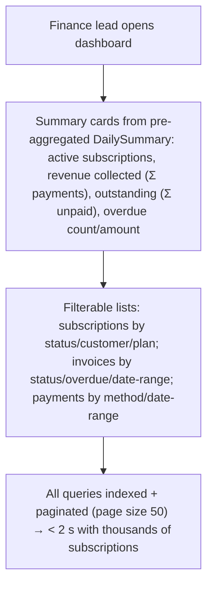

---

## 4. Data model — ER diagram (Mermaid)

```mermaid
erDiagram
    User ||--o{ Subscription : "is customer of"
    User ||--o{ Payment : "recorded_by"
    User ||--o{ AuditLog : "actor"
    User ||--o| PasswordResetToken : "has"
    Product ||--o{ VariantGroup : "has"
    VariantGroup ||--o{ VariantOption : "has"
    Product ||--o{ Plan : "offered_as"
    Plan ||--o{ QuotationTemplate : "uses"
    Plan ||--o{ Subscription : "governs"
    QuotationTemplate ||--o{ Quotation : "instantiated_as"
    Quotation ||--|| Subscription : "converts_to"
    Subscription ||--o{ SubscriptionLine : "has"
    SubscriptionLine }o--|| Product : "references"
    Subscription ||--o{ Invoice : "billed_as"
    Invoice ||--o{ InvoiceLine : "has"
    Invoice ||--o{ Payment : "settled_by"
    Invoice ||--o{ Notification : "triggers"
    Subscription ||--o{ Notification : "triggers"
    TaxRule }o--o{ InvoiceLine : "applies_to"
    DiscountRule }o--o{ Invoice : "applies_to"

    User {
        int id PK
        string name
        string email UK "one account per email"
        string password_hash
        enum role "ADMIN / STAFF / CUSTOMER"
        bool is_active
    }
    Product {
        int id PK
        string name
        string type
        decimal sales_price
        decimal cost_price
        string notes
        bool is_active
    }
    VariantOption {
        int id PK
        int group_id FK
        string value "e.g. Odoo"
        decimal price_delta "e.g. +560"
    }
    Plan {
        int id PK
        int product_id FK
        decimal price
        enum billing_frequency "daily/weekly/monthly/yearly"
        int min_quantity
        date available_from
        date available_to
        bool auto_close_on_end
        bool allow_early_close
        bool allow_pause
        bool allow_renew
    }
    Subscription {
        int id PK
        string number UK "SUB-YYYY-NNNN"
        int customer_id FK
        int plan_id FK
        date start_date
        date expiry_date
        date next_billing_date
        string payment_terms
        enum status "Draft/Quotation/Confirmed/Active/Paused/Closed"
    }
    Invoice {
        int id PK
        string number UK
        int subscription_id FK
        int customer_id FK
        date period_start
        date period_end
        enum status "Draft/Confirmed/Paid/Cancelled"
        decimal subtotal
        decimal tax_total
        decimal discount_total
        decimal total
        date due_date
        UNIQUE subscription_id + period_start "never billed twice"
    }
    Payment {
        int id PK
        int invoice_id FK
        string method "cash/bank/card/UPI/other"
        decimal amount
        date payment_date
        string note
        int recorded_by FK
    }
    DiscountRule {
        int id PK
        enum type "fixed/percent"
        decimal value
        decimal min_amount
        int min_quantity
        date start_date
        date end_date
        int max_uses
        int used_count
        enum scope "products/subscription"
    }
```

---

## 5. Module specifications

### M1 — Authentication & Access Control (RBAC)
**Goal:** Secure sign-in where "not everyone who logs in sees the same things." *(Diagram 3.1)*

**What to add**
- Customer self-signup (email + password), login/logout (JWT sessions)
- Password policy validation (server-side)
- Forgot-password → reset link emailed to the registered address, expiring token
- Roles: `ADMIN`, `STAFF`, `CUSTOMER`; admin-only staff creation
- Role middleware on every API route; row-level isolation for customers

**Requirements (traced to PS)**
- R1. One account per email → unique constraint on `email`. *"Each email can belong to only one account."*
- R2. Password > 8 chars, ≥1 uppercase, ≥1 lowercase, ≥1 special char. *"…more than eight characters, with an uppercase letter, a lowercase letter and a special character."*
- R3. Reset link arrives at the registered email. *"…a reset link should arrive at their registered email."*
- R4. RBAC: admin = whole system; staff = limited day-to-day; customer = own portal only.
- R5. Only admin can add staff. *"Only the admin can add a new member of staff."*
- R6. Customer data isolation enforced server-side (customer sees only own subscriptions/invoices).

**APIs:** `POST /auth/signup`, `POST /auth/login`, `POST /auth/forgot-password`, `POST /auth/reset-password`, `GET /me`, `POST /admin/staff` (admin)
**Edge cases:** duplicate email → 409; weak password → 400 with rule list; expired token → 400; staff calling admin route → 403; cross-customer access → 403/404.

---

### M2 — Product & Variant Catalog
**Goal:** Admin defines what is sold, including variants that change the price.

**What to add**
- Product CRUD (admin): name, type, sales price, cost price, notes, active flag
- Variant groups per product (e.g. `Brand`) with options and price deltas (e.g. `Odoo = +560`)
- Effective price = base sales price + selected variant deltas

**Requirements**
- P1. Product fields: name, type, sales price, cost price, notes. *"…adds it with its name, type, sales price, cost price and notes."*
- P2. Variants adjust price. *"…offers it in variants, for example by brand, where choosing the Odoo brand adds 560 to the price."*
- P3. Only admin creates/edits products.
- P4. Soft-delete only: a product referenced by subscription lines cannot be hard-deleted.

**APIs:** `CRUD /products` (admin), `CRUD /products/{id}/variants`, `GET /products` (staff/customer for quoting/portal)
**Edge cases:** negative total price → reject; deleting in-use product → soft delete + 409 on hard delete.

---

### M3 — Plan Management
**Goal:** Define *how* something is billed recurringly and what happens at the end.

**What to add**
- Plan CRUD (admin): name, linked product, price, billing frequency, min quantity, availability dates
- Billing frequency ∈ {daily, weekly, monthly, yearly}
- Per-plan end-behavior flags: `auto_close_on_end`, `allow_early_close`, `allow_pause`, `allow_renew`

**Requirements**
- PL1. Plan = cost + billing frequency (daily/weekly/monthly/yearly) + minimum quantity + availability dates. *"…what it costs and how often it bills (daily, weekly, monthly or yearly), the minimum quantity, and the dates it is available."*
- PL2. Some plans close on their own at the end; others can be closed early, paused or renewed — decided per plan by admin. *"Some plans should close on their own when they end, and others can be closed early, paused or renewed. The admin decides which, plan by plan."*
- PL3. Plan not sellable outside its availability window.
- PL4. Min quantity enforced on subscription lines for that plan.

**APIs:** `CRUD /plans` (admin), `GET /plans`, `GET /plans/{id}`
**Edge cases:** new subscription blocked if today outside availability window; flags drive M5 actions (diagram 3.3) and the M6 auto-close job.

---

### M4 — Quotation Templates
**Goal:** Sales reps start from a ready-made offer instead of building from scratch. *(Diagram 3.2)*

**What to add**
- Quotation template CRUD (admin/staff): name, plan, product lines (product/variant, qty, unit price), validity in days
- Instantiate a quotation for a customer from a template
- Validity check: `valid_until = created_at + validity_days`
- Convert quotation → subscription (atomic)

**Requirements**
- Q1. Template already contains the right plan and product lines. *"…start from a quotation template that already has the right plan and product lines."*
- Q2. Stays valid for a set number of days. *"…and stays valid for a set number of days."*
- Q3. Used for offers to (large) customers; conversion produces a subscription.

**Data:** `QuotationTemplate(id, name, plan_id, validity_days, lines, created_by)`; `Quotation(id, template_id, customer_id, status {draft, valid, expired, converted}, valid_until, total)`
**APIs:** `CRUD /templates`, `POST /quotations`, `GET /quotations`, `POST /quotations/{id}/convert`
**Edge cases:** expired quotation cannot be converted → 400; conversion atomic (quotation + subscription + lines in one transaction).

---

### M5 — Subscription Management (core)
**Goal:** Every subscription is a tracked, numbered record with a visible lifecycle. *(Diagrams 3.2, 3.3)*

**What to add**
- Subscription record: unique number (e.g. `SUB-2026-0001`), customer, plan, start date, expiry date, payment terms, lines (product, variant, quantity, unit price, taxes, amount)
- State machine: **Draft → Quotation → Confirmed → Active → Closed** (+ Paused)
- Actions (gated by plan flags): confirm, activate, pause/resume, renew (extends expiry), early close, cancel
- `next_billing_date` computed from start date + frequency; billing skips paused
- Team-wide list/search/filter by status, customer, plan, dates

**Requirements**
- S1. Each subscription gets its own number, a customer, a plan, start date, expiry date and payment terms, with lines showing product, quantity, unit price, taxes and amount. *(verbatim PS)*
- S2. Lifecycle: Draft → Quotation → Confirmed → Active → Closed. *(verbatim PS)*
- S3. Anyone on the team can see where it stands. *"…anyone on the team should be able to see where it stands."*
- S4. Pause / early-close / renew only when the plan allows it (M3 flags).
- S5. Expiry date derived from start + frequency.
- S6. Plan min quantity enforced on lines.
- S7. Auto-close at expiry when `plan.auto_close_on_end` (scheduler job).

**Data:** `Subscription(id, number UNIQUE, customer_id, plan_id, quotation_id NULL, start_date, expiry_date, next_billing_date, payment_terms, status, paused_at, closed_at)`; `SubscriptionLine(id, subscription_id, product_id, variant_option_ids, quantity, unit_price, tax_ids, line_total)`
**APIs:** `POST /subscriptions` (from quotation), `GET /subscriptions?status=&customer=&plan=`, `GET /subscriptions/{id}` (with status history), `POST /subscriptions/{id}/{confirm|activate|pause|resume|renew|close|cancel}`
**Edge cases:** illegal transition → 409; pause blocks M6 billing; renew recomputes expiry & next_billing_date; close sets `closed_at` and stops future billing.

---

### M6 — Billing & Invoicing Engine
**Goal:** Billing day runs itself — hundreds of invoices, none typed by hand, none duplicated, none skipped. *(Diagrams 3.4, 3.5)*

**What to add**
- Scheduler job (cron/Celery-beat) + manual trigger: find all `Active` subscriptions with `next_billing_date <= today` and not paused
- Generate one invoice per due subscription for the period `[period_start, period_end)`
- **Idempotency:** DB unique constraint on `(subscription_id, period_start)` → a period can never be billed twice; due-check ensures none skipped; BillingRun log for audit
- Invoice auto-filled: customer details, product lines, taxes (M7), discounts (M7), totals, due date from payment terms
- Invoice lifecycle: **Draft → Confirmed → Paid** (+ Cancelled)
- Actions: confirm, cancel, send (email with PDF), print (PDF)
- After billing, advance `next_billing_date` by one period

**Requirements**
- B1. On billing day each due subscription produces an invoice automatically — hundreds at once. *"Each one should be created from its subscription…"*
- B2. Invoice carries customer details, product lines, taxes and totals already filled in.
- B3. Taxes calculated automatically from admin rules (M7).
- B4. Team can confirm, cancel, send or print any invoice. *"The team can confirm, cancel, send or print any invoice."*
- B5. Invoice states: Draft → Confirmed → Paid. *(verbatim PS)*
- B6. Nothing billed twice or skipped. *"Nothing should be billed twice or skipped."* → unique key + due scan + run log + transaction per invoice.

**Data:** `Invoice(id, number UNIQUE, subscription_id, customer_id, period_start, period_end, status, lines…, subtotal, tax_total, discount_total, total, due_date, sent_at, paid_at, UNIQUE(subscription_id, period_start))`; `BillingRun(id, started_at, finished_at, created_count, skipped_count, errors)`
**APIs:** `POST /billing/run` (staff), `GET /invoices?status=&customer=&overdue=`, `GET /invoices/{id}`, `POST /invoices/{id}/{confirm|cancel|send}`, `GET /invoices/{id}/pdf`
**Edge cases:** paused/closed subscriptions skipped; already-billed period skipped silently (idempotent); total floored at 0 after discounts; partial payments keep Confirmed until fully paid → Paid.

---

### M7 — Tax & Discount Rules Engine
**Goal:** Admin-defined money rules that apply themselves on every invoice. *(Diagram 3.6)*

**What to add**
- **Tax rules (admin CRUD):** name, type (percentage/fixed), value, scope (all products or specific products), active
- **Discount rules (admin-only):** fixed amount or percentage; min purchase amount OR min quantity; start & end dates; max usage count; scope = specific products OR whole subscription
- Evaluation engine called by M6 at invoice creation: per-line taxes → product-scoped discounts → subscription-scoped discounts → totals
- Discount auto-applies on the *next* invoice and **stops when expired or when the usage limit is reached** (`used_count` incremented on invoice confirm)

**Requirements**
- T1. Taxes calculated automatically from rules the admin set. *(verbatim PS)*
- D1. Only the admin can create discount rules. *"Only the admin can create discount rules."*
- D2. Discount = fixed amount or percentage, with min purchase/quantity, start & end dates, and a usage limit. *(verbatim PS)*
- D3. Applies to specific products or whole subscriptions. *"A discount can apply to specific products or to whole subscriptions."*
- D4. Once it applies it appears on the next invoice automatically and stops when it expires/runs out. *"…should appear on the next invoice on its own… and stop when it expires or runs out."*

**Data:** `TaxRule(id, name, type {percent,fixed}, value, product_ids NULL=all, is_active)`; `DiscountRule(id, name, type, value, min_amount, min_quantity, start_date, end_date, max_uses, used_count=0, scope {products,subscription}, product_ids NULL, is_active, created_by_admin)`
**APIs:** `CRUD /taxes` (admin), `CRUD /discounts` (admin), internal `POST /pricing/evaluate`
**Edge cases:** percent capped ≤ 100; expired/exhausted discount silently not applied; usage count only on confirmed invoices.

---

### M8 — Payments & Outstanding Tracking
**Goal:** Every rupee matched to the right invoice; overdue visible before it becomes lost revenue. *(Diagram 3.7)*

**What to add**
- Record payment against an invoice: method (cash/bank/card/UPI/other), amount, date, note, recorded-by
- Partial payments supported; invoice flips to `Paid` when Σpayments ≥ total
- Outstanding view: paid vs unpaid; `overdue = not paid/cancelled AND due_date < today`
- Aging report: 0–30 / 31–60 / 61–90 / 90+ days

**Requirements**
- PAY1. Each payment recorded with method, amount, date and a note, against the right invoice. *(verbatim PS)*
- PAY2. At any moment the team sees which invoices are paid and which are outstanding. *"…the team should be able to see which invoices are paid and which are still outstanding."*
- PAY3. Overdue ones chased before they turn into lost revenue → overdue filter + M11 reminders.

**Data:** `Payment(id, invoice_id, method, amount, payment_date, note, recorded_by, created_at)`
**APIs:** `POST /payments`, `GET /payments?invoice_id=&method=&from=&to=`, `GET /invoices/outstanding`, `GET /reports/aging`
**Edge cases:** payment on cancelled invoice → 400; overpayment → reject/flag credit; future payment date → 400; deleting a payment re-opens the invoice.

---

### M9 — Customer Self-Service Portal
**Goal:** Customers see and manage their own world without emailing anyone. *(Diagram 3.8)*

**What to add**
- Customer dashboard: my subscriptions (status, plan, next billing, expiry), my invoices + PDF, my payments
- Self-actions gated by plan flags: pause, resume, renew, request early close
- Profile view/update

**Requirements**
- C1. Customers see only their own subscriptions and invoices through a portal. *(verbatim PS)*
- C2. Customers can manage their own subscriptions (without emailing staff).
- C3. Isolation enforced server-side (query always scoped `customer_id = current_user`).

**APIs:** `GET /portal/overview`, `GET /portal/subscriptions`, `GET /portal/invoices`, `GET /portal/invoices/{id}/pdf`, `POST /portal/subscriptions/{id}/{pause|resume|renew|close}`
**Edge cases:** another customer's invoice → 403; portal action violating plan flag → 409.

---

### M10 — Dashboard, Reports & Analytics (Finance)
**Goal:** The finance lead's end-of-month questions answered in one place, in under 2 seconds. *(Diagram 3.9)*

**What to add**
- Summary cards: active subscriptions count, revenue collected (Σ payments), outstanding (Σ unpaid), overdue (count + amount)
- Filterable lists: subscriptions by status/customer/plan/date-range; invoices by status/overdue/customer/date-range; payments by method/date-range
- Summary view + revenue trend (MRR-style)
- **Performance engineering:** indexes on `subscriptions(status, customer_id, next_billing_date)`, `invoices(status, customer_id, due_date, period_start)`; pre-aggregated `DailySummary` refreshed by a job; pagination (default 50); bounded date ranges

**Requirements**
- F1. One place to see active subscriptions, revenue, payments and overdue invoices, with filters and a summary view. *(verbatim PS)*
- F2. Instantly answer: How many subscriptions are active? How much revenue came in? How much is still owed? Which invoices are overdue?
- F3. **NFR:** with thousands of subscriptions on the books, every page responds in under two seconds. *"With thousands of subscriptions on the books, every page should still respond in under two seconds."*

**Data:** `DailySummary(date PK, active_subs, revenue_collected, outstanding, overdue_count, overdue_amount)`
**APIs:** `GET /dashboard/summary`, `GET /reports/subscriptions`, `GET /reports/invoices?overdue=1`, `GET /reports/payments`, `GET /reports/revenue?from=&to=`
**Edge cases:** unbounded queries rejected; load-test with 10k+ subscriptions, assert p95 < 2 s.

---

### M11 — Notifications, Reminders & Audit
**Goal:** Nothing relies on memory; everything is traceable.

**What to add**
- Renewal reminders: email customer X days before subscription expiry (fixes "renewals remembered by whoever notices first")
- Overdue-invoice reminders to customer + alert to staff
- Invoice "sent" email with PDF (M6 send action)
- Audit log on every entity: who did what, when, old → new value

**Requirements**
- N1. Renewals must not be missed → automated reminder before expiry.
- N2. Overdue invoices chased automatically → scheduled overdue scan + notifications.
- N3. Team-wide visibility of status → audit/status history on subscription, invoice, payment.

**Data:** `Notification(id, type {renewal_reminder, overdue_reminder, invoice_sent}, recipient, channel, payload, sent_at, status)`; `AuditLog(id, entity_type, entity_id, actor_id, action, old_value, new_value, at)`
**APIs:** `GET /audit?entity=&entity_id=`; scheduler jobs internal; email via SMTP (mock in dev)
**Edge cases:** failed notification → logged + retried; reminders idempotent per period.

---

## 6. Cross-cutting (non-functional) requirements

| Area | Requirement |
|---|---|
| Security | Hashed passwords (bcrypt/argon2); JWT with expiry; RBAC middleware on every route; server-side validation; ORM/parameterized queries; customer row-level isolation |
| Performance | < 2 s page loads with thousands of subscriptions (indexes + aggregates + pagination) — F3 |
| Reliability | Billing run transactional per invoice; unique `(subscription_id, period_start)` guarantees no double billing; nothing skipped via due-date scan + BillingRun log |
| Data integrity | Unique emails, subscription numbers, invoice numbers; soft deletes for in-use catalog items; atomic quote→subscription conversion |
| Usability | Clear status badges, filters everywhere, invoice PDF print/send |
| Observability | BillingRun log, AuditLog, Notification log |
| Suggested stack | Backend: Django REST / Express / Spring Boot · Frontend: React · DB: PostgreSQL · Scheduler: Celery-beat / cron · Auth: JWT · PDF: ReportLab/WeasyPrint · Email: SMTP (mock in dev) |

---

## 7. Build order (sprints)

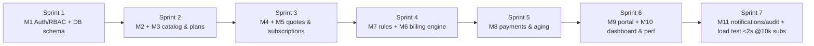
